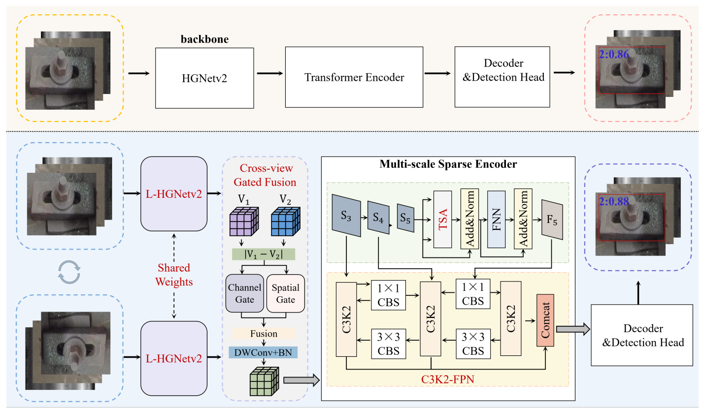
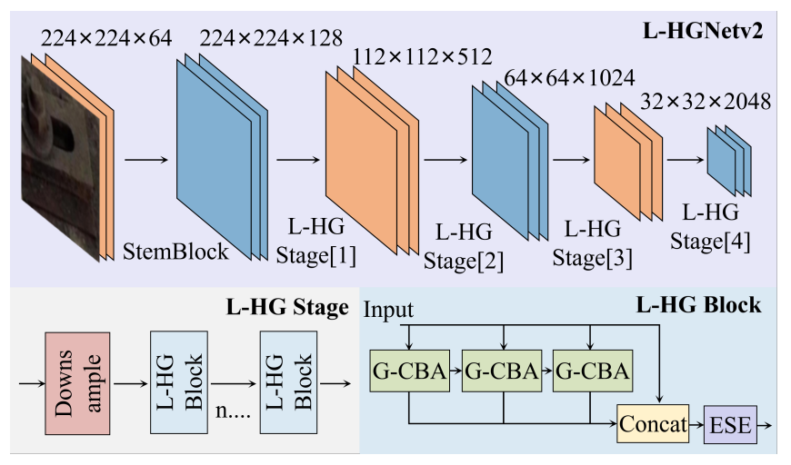
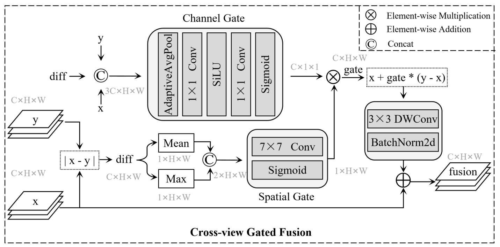
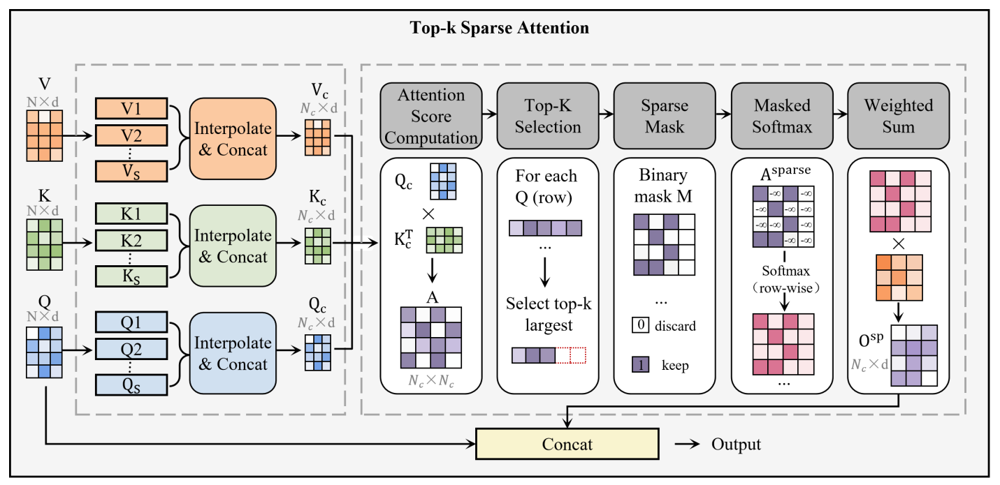

# LM2-DETR-A-Lightweight-DETR-with-Multi-View-and-Multi-Scale-Fusion-for-Crane-Track-Defect-Detection

**LM2-DETR (LM²-DETR)** is our proposed lightweight detector for crane track defect detection. It combines a lightweight backbone, shared-weight multi-view learning, gated feature fusion, and multi-scale sparse encoding to improve defect localization with a compact model.

**D-FINE-n is the baseline for this work.** LM2-DETR extends its implementation with the proposed L-HGNetv2, TSA, CGF, and C3K2-FPN components. This repository presents LM2-DETR; upstream attribution is provided in the acknowledgments.



*Figure 1 from the paper. Top: the D-FINE baseline. Bottom: our LM2-DETR with shared-weight L-HGNetv2 branches, Cross-view Gated Fusion, and a multi-scale sparse encoder.*

## Paper information

- **Title:** LM²-DETR: A Lightweight DETR with Multi-View and Multi-Scale Fusion for Crane Track Defect Detection.
- **Authors:** Xudong Chen, Lei Wu, Yinbing Tao, Wukang Gao, Xinmin Cheng, and Hongwei Yin.

Publication links, final experiment configurations, and pretrained checkpoint links are pending. Results below are reported in the manuscript; reproduction with this checkout has not yet been validated.

## Method

The manuscript introduces four components:

1. **L-HGNetv2:** GhostConv-based G-CBA units reduce backbone parameter redundancy.
2. **Top-k Sparse Attention (TSA):** selective attention emphasizes informative token interactions.
3. **Cross-view Gated Fusion (CGF):** original and 180-degree rotated images pass through a shared-weight backbone; channel and spatial gates control auxiliary-view fusion.
4. **C3K2-FPN:** C3K2 refinement strengthens top-down and bottom-up multi-scale feature aggregation.

The manuscript retains the D-FINE decoder and training objective without adding loss terms. Parameter reduction does not imply lower total FLOPs: the manuscript reports an increase from 7.1 to 8.1 GFLOPs due to the auxiliary forward path.

### Lightweight backbone



*Figure 2 from the paper. L-HGNetv2 preserves hierarchical feature extraction while using GhostConv-based G-CBA units to build lightweight HG blocks.*

### Cross-view Gated Fusion



*Figure 4 from the paper. Channel and spatial gates use cross-view differences to control auxiliary information, followed by depthwise refinement and residual fusion.*

### Top-k Sparse Attention



*Figure 5 from the paper. Multi-scale Q/K/V compression and Top-k selection focus attention on informative token interactions.*

## Code organization

The current source tree includes:

- An HGNetv2 backbone with GhostConv components in `src/nn/backbone/hgnetv2.py` and D-FINE detection components.
- An optional 180-degree rotated auxiliary branch and cross-view fusion in `src/zoo/dfine/dfine.py`.
- Channel/spatial gated fusion with depthwise refinement in `src/nn/backbone/NewCWAM.py`. The active class retains the historical name `CrossWinBasedAttention`; its current forward implementation is gated fusion, not Q/K/V window attention.
- A C3K2 encoder variant with native sparse attention in `src/zoo/dfine/hybrid_encoder_C3K2.py`.
- Training, COCO-format evaluation, and image/video inference entry points.

Some source directories, class names, and configuration filenames retain the upstream `dfine` naming for compatibility. These names identify the inherited code structure; the proposed method is **LM2-DETR**. The checkout also contains experimental variants, so the configuration must be matched to its checkpoint before evaluation.

## Repository structure

```text
assets/figures/                 Method figures extracted from the LM2-DETR paper
configs/                       Dataset, model, optimizer, and runtime configurations
src/core/                      YAML configuration and component registration
src/data/                      Datasets, transforms, and evaluation utilities
src/nn/                        Backbones and neural network components
src/zoo/dfine/                 Detector, encoders, decoder, losses, and postprocessor
src/solver/                    Training and validation loops
src/optim/                     Optimization utilities
src/misc/                      Shared utilities
tools/inference/torch_inf.py   PyTorch image/video inference
train.py                       Training and evaluation entry point
requirements_DFINE.txt         Existing development-environment dependency snapshot
LICENSE                        Existing Apache-2.0 license text
```

Datasets, checkpoints, and generated training outputs are not included in the intended source release.

## Environment

**Manuscript environment (Section 4.2):** Ubuntu, Python 3.8, PyTorch 2.3.1, CUDA 12.1, cuDNN 8.9.2, Intel Xeon Gold 5418Y CPU, and NVIDIA GeForce RTX 4090 GPU.

**Current workspace records:** the existing dependency snapshot pins PyTorch 2.5.1 and torchvision 0.20.1, while the local training guide suggests Python 3.11.9. These differ from the manuscript and do not constitute a freshly verified installation environment.

For exploring the current checkout, an example isolated environment is shown below. It is not the paper's recorded environment:

```bash
conda create -n lm2-detr python=3.11.9 -y
conda activate lm2-detr
```

Review `requirements_DFINE.txt` before installation. It contains CUDA packages, TensorRT, deployment tools, and `MultiScaleDeformableAttention==1.0`; some entries may need platform-specific installation or a separate build source. It is a development snapshot, not a portable minimal requirements file. The source also imports `timm` from `NewCWAM.py`, but `timm` is absent from the snapshot; its tested version must be recorded for the publication release.

If the environment supports every listed dependency, install the snapshot with:

```bash
python -m pip install -r requirements_DFINE.txt
```

Before publishing, provide a tested environment specification, including Python, PyTorch, torchvision, timm, CUDA, and GPU details. Training and inference have not been rerun as part of preparing this README.

## Dataset preparation

The manuscript evaluates three datasets:

| Dataset | Description | Number of classes |
| --- | --- | ---: |
| RFDDs | Collected crane fastener images | 4 |
| RSDDs | Public rail surface defect dataset | 1 |
| CRDDs | Combined fastener and rail surface defect dataset | 5 |

The manuscript describes 500 original fastener images, DCGAN-based expansion and image augmentation, and an expanded collection of 800 images split **7:2:1 into training:test:validation**. Exact per-dataset counts, split manifests, and augmentation provenance must still be supplied; the text does not establish all three datasets' individual split sizes. Record the assignment of original images and their derived samples so the split can be checked and reproduced.

The manuscript states: “Data will be made available on request.” Dataset download links and request instructions have not yet been supplied for this release. Directory names such as `rail-mix-coco`, `rail4`, and `RSDDsv2` must be checked against the manuscript dataset identities before being presented as official mappings.

Provide images and annotations in COCO detection format. One layout supported by the project is:

```text
datasets/rail-mix-coco/
├── train/
├── val/
└── Annotations/
    ├── train.json
    └── val.json
```

Each annotation file must contain `images`, `annotations`, and `categories`. Image `file_name` values must resolve relative to the corresponding image directory; bounding boxes use COCO `[x, y, width, height]` coordinates.

Edit the dataset YAML referenced by your model configuration:

- Set `train_dataloader.dataset.img_folder` and `ann_file`.
- Set `val_dataloader.dataset.img_folder` and `ann_file`.
- Set `num_classes` to match the annotation categories.
- For custom categories numbered contiguously from `0` to `num_classes - 1`, set `remap_mscoco_category: False`.

The current `configs/dataset/railmix_detection.yml` contains machine-specific absolute paths and sets `remap_mscoco_category: True`. That option applies the built-in MS COCO category mapping; it is not a general custom-category remapper. Check the actual category IDs before running. If IDs are non-contiguous or start at 1, prepare a consistent mapping for annotations and output interpretation.

For publication, document the dataset source/access conditions, class names and IDs, preprocessing, and the exact training/validation/test split. Supply split manifests or generation scripts where redistribution is permitted. Do not describe validation-set measurements as held-out test results.

## Training and evaluation

The manuscript reports 400 epochs, total batch size 8, AdamW, initial learning rate 0.0008, weight decay 0.0001, 640 × 640 inputs, and augmentation/collate-policy changes at epoch 360. Match all inherited settings and parameter-group learning rates to the archived experiment configuration.

Run commands from the repository root after preparing the environment and dataset configuration. The configuration below is an existing example, **not a confirmed final paper configuration**. Replace it with the configuration corresponding to your experiment.

### Training

```bash
python train.py -c configs/dfine/custom/dfine_hgnetv2_n_custom.yml --seed 42 --output-dir output/example_run
```

The seed is illustrative; use the paper's actual seed and training settings for reproduction. Record the complete effective configuration, including inherited YAML files and command-line overrides.

### Fine-tuning from a compatible checkpoint

```bash
python train.py -c configs/dfine/custom/dfine_hgnetv2_n_custom.yml -t checkpoints/initial.pth --output-dir output/example_tuning
```

### Resuming a training run

```bash
python train.py -c configs/dfine/custom/dfine_hgnetv2_n_custom.yml -r checkpoints/last.pth
```

Use `-t` for initialization/fine-tuning and `-r` for resuming. They cannot be supplied together. Checkpoint paths above are placeholders for files supplied by the user.

### Evaluation

```bash
python train.py -c configs/dfine/custom/dfine_hgnetv2_n_custom.yml -r checkpoints/model.pth --test-only
```

Evaluation uses the dataset configured under `val_dataloader`. To evaluate a separate test split, point that configuration at the test images and annotations. Use the exact model configuration and category mapping associated with the checkpoint.

## Image and video inference

```bash
python tools/inference/torch_inf.py -c configs/dfine/custom/dfine_hgnetv2_n_custom.yml -r checkpoints/model.pth -i examples/sample.jpg -d cuda:0
```

Replace the input and checkpoint paths with existing files. The script also accepts video input and defaults to CPU if `-d` is omitted. CPU support and GPU execution still need to be checked with the final release environment. Numerical labels must be interpreted using the dataset's class mapping.

## Results and checkpoints

### Results reported in the manuscript

Values below are from manuscript Table 1. AP values are percentages, not locally reproduced measurements.

| Dataset | Model | AP50 (%) | AP75 (%) | AP50:95 (%) |
| --- | --- | ---: | ---: | ---: |
| CRDDs | D-FINE-n | 88.7 | 86.9 | 74.7 |
| CRDDs | LM²-DETR | 88.6 | 87.2 | 75.3 |
| RFDDs | D-FINE-n | 90.1 | 85.6 | 74.5 |
| RFDDs | LM²-DETR | 94.5 | 92.4 | 81.1 |
| RSDDs | D-FINE-n | 91.7 | 66.5 | 59.5 |
| RSDDs | LM²-DETR | 94.7 | 75.3 | 61.9 |

Table 1 reports 3.1M parameters and 8.1 GFLOPs for LM²-DETR, versus 3.7M and 7.1 GFLOPs for D-FINE-n. Table 2 gives parameter counts at higher precision: **3.11M versus 3.75M**, a reduction of approximately **17.1%**. On CRDDs, AP75 and AP50:95 improve by 0.3 and 0.6 percentage points, respectively; AP50 decreases by 0.1 percentage point.

### Component ablation on CRDDs

Transcribed from manuscript Table 2:

| Variant | Components added to baseline | Parameters (M) | AP50 (%) | AP75 (%) | AP50:95 (%) |
| --- | --- | ---: | ---: | ---: | ---: |
| D-FINE | Baseline | 3.75 | 88.7 | 86.9 | 74.7 |
| LCR-1 | Ghost | 2.89 | 87.9 | 86.2 | 73.8 |
| LCR-2 | Ghost + TSA | 2.71 | 87.6 | 85.5 | 73.4 |
| LCR-3 | Ghost + TSA + C3K2-FPN | 3.00 | 88.4 | 87.0 | 74.4 |
| LM²-DETR | Ghost + TSA + C3K2-FPN + CGF | 3.11 | 88.6 | 87.2 | 75.3 |

Tables 3–4 additionally evaluate G1–G4 GhostConv replacement patterns, BiFPN, and C3K2 expansion ratios 0.50, 0.75, and 1.00. The manuscript selects G3 and ratio 0.75. Their configuration/checkpoint mappings remain pending.

### Checkpoints and reproducibility

No checkpoint download links have been verified for this release. Before publication, link each main result and ablation to its configuration, checkpoint, evaluation split, and reproduction command.

Report AP definitions explicitly. For speed or complexity measurements, also specify input resolution, batch size, hardware, software versions, precision, warm-up, measured iterations, and whether preprocessing/postprocessing are included. Use one consistent protocol for comparisons.

Large model files can be distributed separately; document checkpoint filenames, download links, and checksums here when available.


## Citation

Until publication metadata is available, the manuscript may be identified as:

Xudong Chen, Lei Wu, Yinbing Tao, Wukang Gao, Xinmin Cheng, and Hongwei Yin. *LM²-DETR: A Lightweight DETR with Multi-View and Multi-Scale Fusion for Crane Track Defect Detection*. Manuscript.

The manuscript cites the upstream work as: Yansong Peng et al., *D-FINE: Redefine Regression Task in DETRs as Fine-grained Distribution Refinement*, ICLR 2025. Add the final paper DOI and verified BibTeX entries when available.
