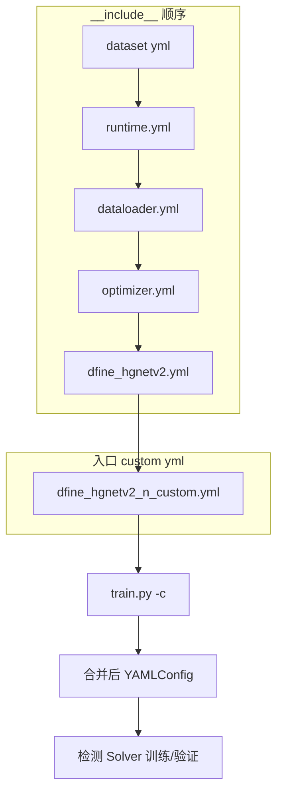

# D-FINE 铁路数据集训练指南

本文档说明如何在 `D-FINE-master` 项目中，使用 `datasets/` 目录下的铁路相关数据集进行目标检测训练、验证与微调。

- **§3**：`configs/dataset/*.yml` 写法（各数据集模板）  
- **§4**：YAML 配置体系、`__include__` 合并、runtime / dataloader / 模型 custom 写法  
- **§5 起**：训练命令、超参、排错  

---

## 1. 目录与配置对应关系

### 1.1 数据集目录（`datasets/`）

| 目录 | 格式 | 类别数 | 说明 |
|------|------|--------|------|
| `rail-mix-coco/` | COCO | 5 | normal、missing、facture、loose、surface damage |
| `rail4` / `rail-mix/` | YOLO | 4 / 5 | 仅标签，**需先转为 COCO** 才能训练 |
| `rail4_coco/` | 部分 COCO JSON | 4 | 需整理为下方标准目录结构 |
| `rail-mix-coco.zip` | 压缩包 | — | 解压后应包含图片与标注 |

### 1.2 推荐 COCO 目录结构

```text
datasets/rail-mix-coco/
├── train/                          # 训练图片（jpg/png）
├── val/                            # 验证图片
└── Annotations/
    ├── train.json                  # COCO 标注
    └── val.json
```

要求：

- `train.json` / `val.json` 中 `images[].file_name` 与对应文件夹内文件名一致。
- `categories` 中 `id` 从 **0** 连续编号（本项目标注已满足）。
- 每个 split 下必须有真实图片文件，仅有 JSON 无法训练。

### 1.3 模型配置与数据集映射

| 模型规模 | 配置文件 | 引用的数据集配置 |
|----------|----------|------------------|
| N（轻量） | `configs/dfine/custom/dfine_hgnetv2_n_custom.yml` | `configs/dataset/railmix_detection.yml`（5 类） |
| S | `configs/dfine/custom/dfine_hgnetv2_s_custom.yml` | `configs/dataset/rail4.yml`（4 类） |
| M / L / X | `configs/dfine/custom/dfine_hgnetv2_{m,l,x}_custom.yml` | `configs/dataset/custom_detection.yml`（需自行填写路径） |

训练前请先确认：所用 **模型 yml** 引用的 **dataset yml** 与你要训练的数据集一致（详见 §3.4、§4.2、§4.7）。

---

## 2. 环境准备

### 2.1 Conda 环境（推荐）

```bash
cd D-FINE-master
conda create -n dfine python=3.11.9 -y
conda activate dfine
```

### 2.2 依赖安装

按官方 README 安装（若仓库根目录有 `requirements.txt`）：

```bash
pip install -r requirements.txt
```

并安装与 CUDA 版本匹配的 PyTorch，例如：

```bash
pip install torch torchvision --index-url https://download.pytorch.org/whl/cu124
```

关键依赖包括：`faster-coco-eval`、`PyYAML`、`tensorboard` 等（以 README 为准）。

### 2.3 预训练权重（可选）

- **Backbone（HGNetv2）**：放到 `weight/hgnetv2/`，配置中 `HGNetv2.local_model_dir` 已指向该目录。
- **完整 D-FINE COCO 权重**：从 [官方 Release](https://github.com/Peterande/storage/releases/tag/dfinev1.0) 下载，用于 `-t` 微调。

---

## 3. 修改数据集配置（必做）

编辑 `configs/dataset/railmix_detection.yml`（5 类）或 `rail4.yml`（4 类）。

### 3.1 示例：`rail-mix-coco`（5 类）

将路径改为本机绝对路径（Windows 建议使用正斜杠 `/`）：

```yaml
task: detection

evaluator:
  type: CocoEvaluator
  iou_types: ['bbox', ]

num_classes: 5
remap_mscoco_category: False    # 自定义数据集必须为 False

train_dataloader:
  type: DataLoader
  dataset:
    type: CocoDetection
    img_folder: d:/LearningSelections/D-FINE-master/datasets/rail-mix-coco/train
    ann_file: d:/LearningSelections/D-FINE-master/datasets/rail-mix-coco/Annotations/train.json
    return_masks: False
    transforms:
      type: Compose
      ops: ~
  shuffle: True
  num_workers: 4
  drop_last: True
  collate_fn:
    type: BatchImageCollateFunction

val_dataloader:
  type: DataLoader
  dataset:
    type: CocoDetection
    img_folder: d:/LearningSelections/D-FINE-master/datasets/rail-mix-coco/val
    ann_file: d:/LearningSelections/D-FINE-master/datasets/rail-mix-coco/Annotations/val.json
    return_masks: False
    transforms:
      type: Compose
      ops: ~
  shuffle: False
  num_workers: 4
  drop_last: False
  collate_fn:
    type: BatchImageCollateFunction
```

### 3.2 示例：`rail4`（4 类）

修改 `configs/dataset/rail4.yml`：

- `num_classes: 4`
- `remap_mscoco_category: False`
- `img_folder` / `ann_file` 指向整理好的 `rail4_coco`（或你转换后的 COCO 目录）

### 3.3 重要参数说明

| 参数 | 说明 |
|------|------|
| `num_classes` | 与 `categories` 数量一致（不含背景；D-FINE 内部会处理） |
| `remap_mscoco_category` | 自定义铁路数据 **必须为 `False`**。`True` 仅用于 MSCOCO 官方 80 类 id |
| `img_folder` | 仅放图片的文件夹 |
| `ann_file` | COCO 格式 `*.json` 完整路径 |

### 3.4 每种数据集的 dataset YAML 写法

所有数据集配置放在 `configs/dataset/` 下，由模型 yml 通过 `__include__` 引用，例如：

```yaml
# configs/dfine/custom/dfine_hgnetv2_n_custom.yml 顶部
__include__: [
  '../../dataset/railmix_detection.yml',   # ← 换成你的数据集 yml
  ...
]
```

下面 `ROOT` 统一替换为你的数据根目录，例如：

`ROOT = d:/LearningSelections/D-FINE-master/datasets`

---

#### 通用模板（COCO 格式，复制后改 4 处）

适用于：已整理为标准 COCO 目录的任意检测数据集。

```yaml
task: detection

evaluator:
  type: CocoEvaluator
  iou_types: ['bbox', ]

num_classes: N                    # ← 1) 类别数量
remap_mscoco_category: False      # ← 2) 铁路/自定义数据用 False；官方 COCO 用 True

train_dataloader:
  type: DataLoader
  dataset:
    type: CocoDetection
    img_folder: ROOT/你的数据集/train           # ← 3) 训练图片目录
    ann_file: ROOT/你的数据集/Annotations/train.json  # ← 4) 训练标注
    return_masks: False
    transforms:
      type: Compose
      ops: ~
  shuffle: True
  num_workers: 4
  drop_last: True
  collate_fn:
    type: BatchImageCollateFunction

val_dataloader:
  type: DataLoader
  dataset:
    type: CocoDetection
    img_folder: ROOT/你的数据集/val
    ann_file: ROOT/你的数据集/Annotations/val.json
    return_masks: False
    transforms:
      type: Compose
      ops: ~
  shuffle: False
  num_workers: 4
  drop_last: False
  collate_fn:
    type: BatchImageCollateFunction
```

**`remap_mscoco_category` 怎么选：**

| 数据类型 | 值 | 原因 |
|----------|-----|------|
| MSCOCO 2017（官方 80 类，category_id 1~90） | `True` | 映射到模型内部 0~79 标签 |
| 铁路集 / 自建 COCO（category_id 从 0 连续编号） | `False` | 直接使用 json 里的 `category_id` |
| 选错 | 训练报错或 mAP 接近 0 | |

---

#### ① `rail-mix-coco`（5 类）

| 项目 | 值 |
|------|-----|
| 配置文件名 | `configs/dataset/railmix_detection.yml` |
| 类别 | normal, missing, facture, loose, surface damage |
| `num_classes` | **5** |
| 目录结构 | `train/` + `val/` + `Annotations/train.json` + `val.json` |

```yaml
num_classes: 5
remap_mscoco_category: False

train_dataloader:
  dataset:
    type: CocoDetection
    img_folder: ROOT/rail-mix-coco/train
    ann_file: ROOT/rail-mix-coco/Annotations/train.json

val_dataloader:
  dataset:
    type: CocoDetection
    img_folder: ROOT/rail-mix-coco/val
    ann_file: ROOT/rail-mix-coco/Annotations/val.json
```

模型引用：`dfine_hgnetv2_n_custom.yml` 已默认 include 本文件。

---

#### ② `rail4` / `rail4_coco`（4 类）

| 项目 | 值 |
|------|-----|
| 配置文件名 | `configs/dataset/rail4.yml` |
| 类别 | normal, missing, facture, loose |
| `num_classes` | **4** |

**推荐目录（与 rail-mix 相同）：**

```text
ROOT/rail4_coco/
├── train/              # 图片
├── val/
└── Annotations/
    ├── train.json
    └── val.json
```

```yaml
num_classes: 4
remap_mscoco_category: False

train_dataloader:
  dataset:
    type: CocoDetection
    img_folder: ROOT/rail4_coco/train
    ann_file: ROOT/rail4_coco/Annotations/train.json

val_dataloader:
  dataset:
    type: CocoDetection
    img_folder: ROOT/rail4_coco/val
    ann_file: ROOT/rail4_coco/Annotations/val.json
```

**若暂未整理、仍使用当前仓库布局**（json 在 `train/images/` 下）：

```yaml
train_dataloader:
  dataset:
    img_folder: ROOT/rail4_coco/train/images
    ann_file: ROOT/rail4_coco/train/images/train.json

val_dataloader:
  dataset:
    img_folder: ROOT/rail4_coco/valid/images
    ann_file: ROOT/rail4_coco/valid/images/valid.json
```

模型引用：`dfine_hgnetv2_s_custom.yml` 已默认 include `rail4.yml`。

---

#### ③ `rail4` / `rail-mix` / `RSDDsv2`（YOLO 格式）

D-FINE **没有** YOLO 专用 dataset yml，需先转为 COCO，再按上面 ① 或 ② 写。

```text
ROOT/rail4/          # 或 rail-mix、RSDDsv2
├── images/train/
├── images/val/
└── labels/train/    # 与图片同名的 .txt
```

转换后新建 `configs/dataset/你的名字.yml`，按「通用模板」填写路径与 `num_classes`。

| 数据集 | 建议 `num_classes` |
|--------|-------------------|
| rail4 | 4 |
| rail-mix | 5 |
| RSDDsv2 | 查看 `labels/*/classes.txt` 行数（多为 1 类缺陷检测） |

---

#### ④ `RSDDsv2coco`（单类 COCO）

| 项目 | 值 |
|------|-----|
| 配置文件名 | `configs/dataset/RSDDsv2coco.yml` |
| `num_classes` | **1** |

```yaml
num_classes: 1
remap_mscoco_category: False    # 若 category_id 为 0；若为 COCO 官方 id 则另议

train_dataloader:
  dataset:
    type: CocoDetection
    img_folder: ROOT/RSDDsv2coco/train
    ann_file: ROOT/RSDDsv2coco/Annotations/train.json

val_dataloader:
  dataset:
    type: CocoDetection
    img_folder: ROOT/RSDDsv2coco/val
    ann_file: ROOT/RSDDsv2coco/Annotations/val.json
```

在模型 yml 中把 `__include__` 改为 `'../../dataset/RSDDsv2coco.yml'`。

---

#### ⑤ MSCOCO 2017（官方 80 类）

| 项目 | 值 |
|------|-----|
| 配置文件名 | `configs/dataset/coco_detection.yml` |
| `num_classes` | **80** |
| `remap_mscoco_category` | **True** |

```yaml
num_classes: 80
remap_mscoco_category: True

train_dataloader:
  dataset:
    type: CocoDetection
    img_folder: ROOT/coco2017/train2017
    ann_file: ROOT/coco2017/annotations/instances_train2017.json

val_dataloader:
  dataset:
    type: CocoDetection
    img_folder: ROOT/coco2017/val2017
    ann_file: ROOT/coco2017/annotations/instances_val2017.json
```

模型引用：`configs/dfine/dfine_hgnetv2_{n,s,m,l,x}_coco.yml`（非 custom）。

---

#### ⑥ 任意新数据集（`custom_detection.yml`）

复制 `configs/dataset/custom_detection.yml`，改名为例如 `my_rail.yml`，只改：

1. `num_classes`
2. `remap_mscoco_category: False`（自建数据）
3. 四个路径（train/val 的 `img_folder`、`ann_file`）

M/L/X 模型默认 include `custom_detection.yml`，训练前必须改路径，或改 include 指向你的 yml：

```yaml
# dfine_hgnetv2_m_custom.yml
__include__: [
  '../../dataset/my_rail.yml',
  ...
]
```

---

#### ⑦ CrowdHuman（COCO 格式，1 类）

| 项目 | 值 |
|------|-----|
| 配置文件名 | `configs/dataset/crowdhuman_detection.yml` |
| `num_classes` | **1** |

```yaml
num_classes: 1
remap_mscoco_category: False

train_dataloader:
  dataset:
    img_folder: ROOT/CrowdHuman/CrowdHuman_train
    ann_file: ROOT/CrowdHuman/Chuman-train.json

val_dataloader:
  dataset:
    img_folder: ROOT/CrowdHuman/CrowdHuman_val
    ann_file: ROOT/CrowdHuman/Chuman-val.json
```

---

#### ⑧ Pascal VOC（非 COCO，单独写法）

| 项目 | 值 |
|------|-----|
| 配置文件名 | `configs/dataset/voc_detection.yml` |
| `dataset.type` | **VOCDetection**（不是 CocoDetection） |

```yaml
num_classes: 20

train_dataloader:
  dataset:
    type: VOCDetection
    root: ROOT/voc/
    ann_file: trainval.txt
    label_file: label_list.txt

val_dataloader:
  dataset:
    type: VOCDetection
    root: ROOT/voc/
    ann_file: test.txt
    label_file: label_list.txt
```

铁路 YOLO 数据**不要**用本模板，应转 COCO 后用 CocoDetection。

---

#### ⑨ 配置对照速查

| 数据集 | yml 文件 | num_classes | remap | dataset.type |
|--------|----------|-------------|-------|--------------|
| rail-mix-coco | `railmix_detection.yml` | 5 | False | CocoDetection |
| rail4_coco | `rail4.yml` | 4 | False | CocoDetection |
| RSDDsv2coco | `RSDDsv2coco.yml` | 1 | False | CocoDetection |
| 自建 COCO | `custom_detection.yml` 或新建 | 自定 | False | CocoDetection |
| COCO2017 | `coco_detection.yml` | 80 | True | CocoDetection |
| CrowdHuman | `crowdhuman_detection.yml` | 1 | False | CocoDetection |
| Pascal VOC | `voc_detection.yml` | 20 | — | VOCDetection |
| YOLO (rail4 等) | 先转 COCO 再建 yml | 见 classes.txt | False | CocoDetection |

---

## 4. YAML 配置体系与写法

D-FINE 训练配置由多个 yml **合并**而成。理解合并顺序和每类文件职责，才能正确改数据集、模型和训练超参。

### 4.1 配置文件目录结构

```text
configs/
├── runtime.yml                    # 全局：打印频率、checkpoint、AMP、EMA 默认值
├── dataset/                       # 数据集（路径、类别数、DataLoader）
│   ├── railmix_detection.yml
│   ├── rail4.yml
│   └── custom_detection.yml
└── dfine/
    ├── include/                   # 被 custom/coco yml 引用的公共片段
    │   ├── dataloader.yml         # 增广、batch、num_workers
    │   ├── optimizer.yml          # 默认学习率、调度器（COCO 官方用）
    │   └── dfine_hgnetv2.yml     # 模型结构、损失、后处理
    ├── custom/                    # 铁路 / 自定义训练入口（你要改的）
    │   ├── dfine_hgnetv2_n_custom.yml
    │   ├── dfine_hgnetv2_s_custom.yml
    │   └── dfine_hgnetv2_n_ghost_c3k2_fps.yml
    └── dfine_hgnetv2_n_coco.yml   # 官方 COCO 训练入口
```

训练时 `-c` 指向的是 **最外层入口 yml**（通常在 `configs/dfine/custom/`）。

### 4.2 `__include__` 合并机制

入口 yml 顶部通过 `__include__` 按顺序引入子配置，**后引入或本文件内同名键会覆盖先引入的值**。

以 `dfine_hgnetv2_n_custom.yml` 为例，合并顺序为：

```text
1. configs/dataset/railmix_detection.yml   → num_classes、数据路径
2. configs/runtime.yml                     → checkpoint_freq、use_ema 等
3. configs/dfine/include/dataloader.yml    → 增广、默认 total_batch_size: 32
4. configs/dfine/include/optimizer.yml     → 默认 lr、lr_scheduler（常被 custom 覆盖）
5. configs/dfine/include/dfine_hgnetv2.yml → 模型骨架默认值
6. dfine_hgnetv2_n_custom.yml 本体          → N 模型结构、epoches、batch 等（优先级最高）
```

**换数据集**：改 `__include__` 第一项，或新建 `configs/dataset/xxx.yml` 后替换路径。

```yaml
__include__: [
  '../../dataset/railmix_detection.yml',   # 改成 rail4.yml / 自建 yml
  '../../runtime.yml',
  '../include/dataloader.yml',
  '../include/optimizer.yml',
  '../include/dfine_hgnetv2.yml',
]
```

### 4.3 `configs/runtime.yml`（运行时全局）

一般无需改，除非要调整存盘频率、EMA：

```yaml
print_freq: 100              # 多少 iter 打印一次日志
output_dir: './logs'         # 会被 custom yml 的 output_dir 覆盖
checkpoint_freq: 12          # 每 N 个 epoch 保存

sync_bn: True                # 多卡同步 BN
find_unused_parameters: False

use_amp: False               # 命令行 --use-amp 会启用 AMP
scaler:
  type: GradScaler
  enabled: True

use_ema: False               # custom 里可再开 EMA
ema:
  type: ModelEMA
  decay: 0.9999
  warmups: 1000
```

### 4.4 `configs/dfine/include/dataloader.yml`（数据加载与增广）

定义 **输入尺寸 640×640**、训练增广、默认 batch：

```yaml
train_dataloader:
  dataset:
    transforms:
      ops:
        - {type: RandomPhotometricDistort, p: 0.5}
        - {type: RandomZoomOut, fill: 0}
        - {type: RandomIoUCrop, p: 0.8}
        - {type: RandomHorizontalFlip}
        - {type: Resize, size: [640, 640]}
        - {type: ConvertPILImage, dtype: 'float32', scale: True}
        - {type: ConvertBoxes, fmt: 'cxcywh', normalize: True}
      policy:
        name: stop_epoch
        epoch: 72                    # 72 epoch 后关闭强增广
        ops: ['RandomPhotometricDistort', 'RandomZoomOut', 'RandomIoUCrop']
  collate_fn:
    type: BatchImageCollateFunction
    base_size: 640
    base_size_repeat: 3
    stop_epoch: 72                   # 72 epoch 后关闭多尺度
  total_batch_size: 32
  num_workers: 4

val_dataloader:
  dataset:
    transforms:
      ops:
        - {type: Resize, size: [640, 640]}
        - {type: ConvertPILImage, dtype: 'float32', scale: True}
  total_batch_size: 64
  num_workers: 4
```

在 **custom yml** 里通常只覆盖 batch 和增广停止 epoch，例如：

```yaml
train_dataloader:
  total_batch_size: 8
  dataset:
    transforms:
      policy:
        epoch: 360        # 与 epoches 配合，越接近结束越少增广
  collate_fn:
    stop_epoch: 360
    ema_restart_decay: 0.9999
    base_size_repeat: ~
```

### 4.5 `configs/dfine/include/optimizer.yml`（COCO 默认优化器）

官方 COCO 训练用；**custom 铁路训练一般在入口 yml 里重写 `optimizer` 和 `epoches`**，不必改本文件。

主要字段：`optimizer.type`、`lr`、`params`（按模块名正则分配不同 lr）、`lr_scheduler`、`lr_warmup_scheduler`、`clip_max_norm`。

### 4.6 `configs/dfine/include/dfine_hgnetv2.yml`（模型与损失）

定义检测器骨架，关键字段：

| 块 | 作用 |
|----|------|
| `num_classes` | 来自 dataset yml，决定分类头维度 |
| `eval_spatial_size` | 推理尺度 `[640, 640]` |
| `HGNetv2` | Backbone：`name`（B0~B6）、`pretrained`、`local_model_dir` |
| `HybridEncoder` | 编码器通道、FPN、融合层 |
| `DFINETransformer` | Decoder 层数、`num_queries`、`reg_max` 等 |
| `DFINECriterion` | 损失权重 `weight_dict` |
| `DFINEPostProcessor` | `num_top_queries` |

custom 入口 yml 通过覆盖 `HGNetv2`、`HybridEncoder`、`DFINETransformer` 将默认 **L 级大模型** 改为 **N/S 小模型**。

### 4.7 模型 custom yml 完整写法（铁路训练入口）

在 `configs/dfine/custom/` 新建或修改 `dfine_hgnetv2_*_custom.yml`。

#### 模板（以 N + rail-mix 5 类为例）

```yaml
__include__: [
  '../../dataset/railmix_detection.yml',
  '../../runtime.yml',
  '../include/dataloader.yml',
  '../include/optimizer.yml',
  '../include/dfine_hgnetv2.yml',
]

output_dir: ./output/dfine_hgnetv2_n_custom    # 权重与日志输出目录
print_freq: 10

# ---------- Backbone ----------
DFINE:
  backbone: HGNetv2
DFINE:
  encoder: HybridEncoder

HGNetv2:
  name: 'B0'                    # N 用 B0；S 常用 B0 + 3 尺度；L/X 见官方 coco yml
  return_idx: [2, 3]            # 输出哪几层特征；N 常为 2 层 [2,3]
  freeze_at: -1                 # -1 表示不冻结；0 表示冻结 stem
  freeze_norm: False
  use_lab: True
  block_conv: conv              # conv | ghost（改 ghost 需匹配结构）
  pretrained: False             # 微调时可配合 -t，solver 会关掉 backbone 预训练加载

# ---------- Encoder ----------
HybridEncoder:
  in_channels: [512, 1024]      # 与 return_idx 输出通道一致
  feat_strides: [16, 32]
  hidden_dim: 128
  use_encoder_idx: [1]
  dim_feedforward: 512
  expansion: 0.34
  depth_mult: 0.5

# ---------- Decoder ----------
DFINETransformer:
  feat_channels: [128, 128]
  feat_strides: [16, 32]
  hidden_dim: 128
  dim_feedforward: 512
  num_levels: 2                 # 与特征层数一致
  num_layers: 3
  eval_idx: -1
  num_points: [6, 6]

# ---------- 优化器（覆盖 include/optimizer.yml）----------
optimizer:
  type: AdamW
  params:
    - params: '^(?=.*backbone)(?!.*norm|bn).*$'
      lr: 0.0004
    - params: '^(?=.*backbone)(?=.*norm|bn).*$'
      lr: 0.0004
      weight_decay: 0.
    - params: '^(?=.*(?:encoder|decoder))(?=.*(?:norm|bn|bias)).*$'
      weight_decay: 0.
  lr: 0.0008
  betas: [0.9, 0.999]
  weight_decay: 0.0001

# ---------- 训练日程 ----------
epoches: 400
train_dataloader:
  total_batch_size: 8
  dataset:
    transforms:
      policy:
        epoch: 360
  collate_fn:
    stop_epoch: 360
    ema_restart_decay: 0.9999
    base_size_repeat: ~

val_dataloader:
  total_batch_size: 8
```

#### N 与 S 模型主要差异（铁路 custom）

| 项目 | N (`n_custom`) | S (`s_custom`) |
|------|----------------|----------------|
| dataset include | `railmix_detection.yml` | `rail4.yml` |
| `return_idx` | `[2, 3]`（2 尺度） | `[1, 2, 3]`（3 尺度） |
| `HybridEncoder.in_channels` | `[512, 1024]` | `[256, 512, 1024]` |
| `hidden_dim` | 128 | 256 |
| `num_levels` | 2 | 3（默认 include） |
| `epoches` | 400 | 220 |
| `total_batch_size` | 8 | 16 |
| `output_dir` | `dfine_hgnetv2_n_custom` | `dfine_hgnetv2_s_custom` |

M/L/X：默认 include `custom_detection.yml`，需自行改数据路径，结构接近 `dfine_hgnetv2.yml` 默认大模型。

### 4.8 变体配置示例：`dfine_hgnetv2_n_ghost_c3k2_fps.yml`

用于 Ghost + C3K2 encoder 的 FPS 实验，**不 include dataset/dataloader**，需自行保证数据配置或命令行传入：

```yaml
__include__: [
  '../../runtime.yml',
  '../include/dfine_hgnetv2.yml',
]

output_dir: ./output/dfine_hgnetv2_n_ghost_c3k2_fps
num_classes: 5                    # 直接写在这里，或另 include dataset yml

DFINE:
  backbone: HGNetv2
  encoder: HybridEncoderC3K2      # 注意：不是 HybridEncoder

HGNetv2:
  block_conv: ghost
  return_idx: [2, 3]
  ...

HybridEncoderC3K2:
  in_channels: [512, 1024]
  ...

use_ema: False
val_dataloader:
  total_batch_size: 1
```

训练 FPS 变体时建议补上 dataset include，或复制 `n_custom` 的 `__include__` 并保留 `HybridEncoderC3K2` 相关块。

### 4.9 配置项与修改位置对照

| 想改什么 | 改哪个文件 | 字段 |
|----------|------------|------|
| 数据路径 / 类别数 | `configs/dataset/*.yml` | `img_folder`、`ann_file`、`num_classes` |
| 换训练集 | `custom/*.yml` 顶部 | `__include__` 第一项 |
| 输出目录 | `custom/*.yml` | `output_dir` |
| batch / 显存 | `custom/*.yml` | `train_dataloader.total_batch_size` |
| 训练轮数 | `custom/*.yml` | `epoches` |
| 学习率 | `custom/*.yml` | `optimizer.lr`、`optimizer.params` |
| 输入分辨率 | `include/dataloader.yml` | `Resize, size: [640, 640]` |
| 增广何时关闭 | `custom/*.yml` | `transforms.policy.epoch`、`collate_fn.stop_epoch` |
| Backbone 预训练目录 | `include/dfine_hgnetv2.yml` | `HGNetv2.local_model_dir` |
| 存盘间隔 | `runtime.yml` | `checkpoint_freq` |
| 临时覆盖 | 命令行 | `-u epoches 100`、`-u train_dataloader.total_batch_size 4` |

### 4.10 命令行覆盖 YAML

无需改文件即可试运行：

```powershell
torchrun --nproc_per_node=1 train.py `
  -c configs/dfine/custom/dfine_hgnetv2_n_custom.yml `
  -u epoches 2 train_dataloader.total_batch_size 2 `
  --use-amp --seed=0
```

`train.py` 还支持：

```powershell
  --output-dir ./output/my_exp
  -r output/.../last.pth
  -t weight/dfine_n_coco.pth
```

### 4.11 配置合并关系示意



### 4.12 两类 YAML 分工小结

| 类型 | 路径 | 职责 |
|------|------|------|
| **dataset yml** | `configs/dataset/` | 数据路径、`num_classes`、`CocoDetection` |
| **model custom yml** | `configs/dfine/custom/` | `__include__`、模型结构、优化器、epoch、batch、`output_dir` |

完整铁路训练最少改 **2 个文件**：

1. `configs/dataset/railmix_detection.yml`（或 `rail4.yml`）— 路径与类别  
2. `configs/dfine/custom/dfine_hgnetv2_n_custom.yml`（或 s/m/l/x）— 确认 `__include__` 指向正确 dataset，并按显存调 `total_batch_size`

数据集各模板的逐条写法见 **第 3.4 节**。

---

## 5. 训练

所有命令均在 **`D-FINE-master` 根目录** 执行。

### 5.1 从零训练（单卡，Windows PowerShell）

**5 类 rail-mix（N 模型）：**

```powershell
cd d:\LearningSelections\D-FINE-master
$env:CUDA_VISIBLE_DEVICES = "0"
torchrun --master_port=7777 --nproc_per_node=1 train.py `
  -c configs/dfine/custom/dfine_hgnetv2_n_custom.yml `
  --use-amp --seed=0
```

**4 类 rail4（S 模型）：**

```powershell
torchrun --master_port=7777 --nproc_per_node=1 train.py `
  -c configs/dfine/custom/dfine_hgnetv2_s_custom.yml `
  --use-amp --seed=0
```

### 5.2 从零训练（Linux / 多卡）

```bash
export model=n   # n | s | m | l | x
CUDA_VISIBLE_DEVICES=0,1,2,3 torchrun --master_port=7777 --nproc_per_node=4 \
  train.py -c configs/dfine/custom/dfine_hgnetv2_${model}_custom.yml \
  --use-amp --seed=0
```

`--nproc_per_node` 等于使用的 GPU 数量。

### 5.3 使用 COCO 预训练权重微调

```powershell
torchrun --master_port=7777 --nproc_per_node=1 train.py `
  -c configs/dfine/custom/dfine_hgnetv2_n_custom.yml `
  --use-amp --seed=0 `
  -t path/to/dfine_n_coco.pth
```

说明：`-t` 为 tuning；`-r` 为 resume，二者不能同时使用。

### 5.4 断点续训

```powershell
torchrun --master_port=7777 --nproc_per_node=1 train.py `
  -c configs/dfine/custom/dfine_hgnetv2_n_custom.yml `
  --use-amp -r output/dfine_hgnetv2_n_custom/last.pth
```

### 5.5 仅验证 / 测试

```powershell
torchrun --master_port=7777 --nproc_per_node=1 train.py `
  -c configs/dfine/custom/dfine_hgnetv2_n_custom.yml `
  --test-only -r output/dfine_hgnetv2_n_custom/best_stg1.pth
```

权重文件名以 `output_dir` 下实际生成为准。

---

## 6. 命令行参数速查

| 参数 | 含义 |
|------|------|
| `-c` / `--config` | 训练配置文件（必填） |
| `--use-amp` | 混合精度训练 |
| `--seed` | 随机种子 |
| `-t` | 从预训练/检查点微调 |
| `-r` | 断点续训 |
| `--test-only` | 只跑验证，不训练 |
| `--output-dir` | 覆盖配置中的 `output_dir` |
| `-u key value` | 运行时覆盖 YAML，如 `-u epoches 100` |

---

## 7. 输出与日志

| 配置项 | 默认示例（N 模型） |
|--------|-------------------|
| `output_dir` | `./output/dfine_hgnetv2_n_custom` |
| `epoches` | N 模型约 400（见对应 custom yml） |
| `checkpoint_freq` | 见 `configs/runtime.yml`（默认每 12 epoch 存盘） |

训练结束后在 `output_dir` 查看：

- `best_stg*.pth` / `last.pth` 等检查点
- TensorBoard 日志（若已配置 `summary_dir`）

---

## 8. 超参与显存

### 8.1 批次大小

在模型 custom yml 中修改（§4.7），例如 `dfine_hgnetv2_n_custom.yml`：

```yaml
train_dataloader:
  total_batch_size: 8    # 多卡时为各卡 batch 之和
val_dataloader:
  total_batch_size: 8
```

显存不足时减小 `total_batch_size`（如 4 或 2）。

### 8.2 训练轮数

```yaml
epoches: 400
```

可通过命令行覆盖：

```powershell
torchrun ... train.py -c configs/dfine/custom/dfine_hgnetv2_n_custom.yml -u epoches 200 --use-amp --seed=0
```

### 8.3 输入尺寸

默认在 `configs/dfine/include/dataloader.yml` 中为 `640×640`，一般无需修改。

---

## 9. YOLO 数据转 COCO（可选）

若只有 `rail4/` 或 `rail-mix/`（`images/` + `labels/`），需先转为 COCO JSON，再按第 3 节配置路径。

可参考：

- 官方 README「自定义数据集」章节
- Ultralytics 导出：`yolo export format=coco`
- 自写脚本：读取 `labels/*.txt`，生成 `images`、`annotations`、`categories` 字段

转换后目录仍需符合第 1.2 节结构。

---

## 10. 常见问题

### Q1：报错找不到图片

- 检查 `img_folder` 路径是否正确。
- 确认已解压 `rail-mix-coco.zip`，且 `train/`、`val/` 内有图片。
- 核对 JSON 中 `file_name` 与磁盘文件名一致。

### Q2：类别 id / 损失异常

- 确认 `remap_mscoco_category: False`。
- 确认 `num_classes` 与 `categories` 数量一致。

### Q3：`KeyError` 与 `category_id`

自定义数据 `category_id` 为 0~N-1 时不能使用 `remap_mscoco_category: True`。

### Q4：多卡训练卡住

- 更换 `--master_port`（如 7778）。
- Windows 下建议先用 `--nproc_per_node=1` 验证流程。

### Q5：M/L/X 模型如何训练铁路数据

将 `configs/dataset/custom_detection.yml` 按 §3 改好后，在 `dfine_hgnetv2_m_custom.yml` 的 `__include__` 第一项改为 `railmix_detection.yml` 或 `rail4.yml`，或复制 §4.7 中 N/S 模板（见 §4.9 对照表）。

---

## 11. 推荐训练流程（检查清单）

1. [ ] 解压数据集，确认 `train/`、`val/` 有图片  
2. [ ] 按 §3 修改 `configs/dataset/railmix_detection.yml` 或 `rail4.yml`  
3. [ ] 按 §4.7 确认 `custom/dfine_hgnetv2_*_custom.yml` 的 `__include__` 与 `total_batch_size`  
4. [ ] 创建并激活 `dfine` 环境，安装 PyTorch 与依赖  
5. [ ] 单卡试跑（可用 §4.10 `-u epoches 2` 快速验证）  
6. [ ] 正式训练（§5）；必要时 `-t` 加载 COCO 预训练权重  
7. [ ] `--test-only` 在验证集上评估 `best` 权重  

---

## 12. 相关文件索引

```
D-FINE-master/
├── train.py
├── configs/
│   ├── runtime.yml
│   ├── dataset/                      # 第 3 节、3.4 节
│   │   ├── railmix_detection.yml
│   │   ├── rail4.yml
│   │   └── custom_detection.yml
│   └── dfine/
│       ├── include/
│       │   ├── dataloader.yml        # 第 4.4 节
│       │   ├── optimizer.yml         # 第 4.5 节
│       │   └── dfine_hgnetv2.yml     # 第 4.6 节
│       └── custom/                   # 第 4.7 节（训练 -c 入口）
│           ├── dfine_hgnetv2_n_custom.yml
│           ├── dfine_hgnetv2_s_custom.yml
│           └── dfine_hgnetv2_n_ghost_c3k2_fps.yml
├── datasets/
└── output/
```

**文档章节导航：**

| 章节 | 内容 |
|------|------|
| §3 | dataset yml 写法与各数据集模板 |
| §4 | YAML 体系、`__include__`、模型 custom、runtime/dataloader |
| §5 | 训练命令 |
| §6–§8 | 命令行参数、输出、超参 |

更多细节见项目根目录 [README_cn.md](../README_cn.md)。
<!-- torchrun --master_port=7777 --nproc_per_node=1 train.py -c /mnt/e/project/D-FINE-master/configs/dfine/custom/dfine_hgnetv2_n_custom_new.yml --test-only -r /mnt/e/project/D-FINE-master/output/lightcwam2/best_stg2.pth -->